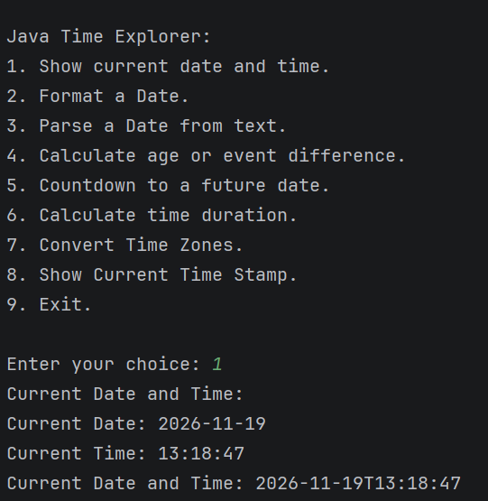
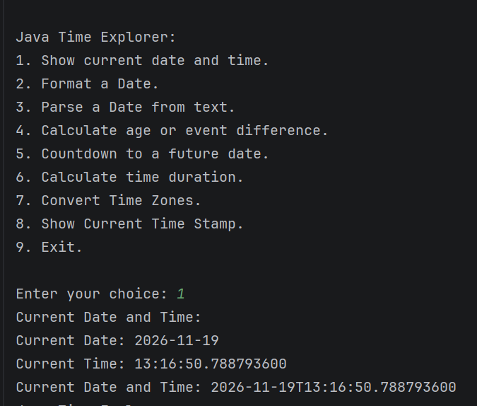
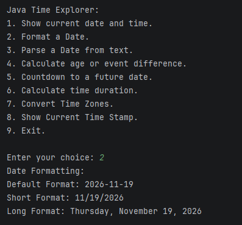
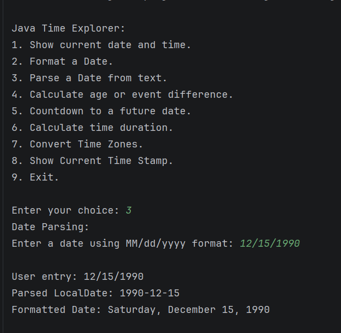
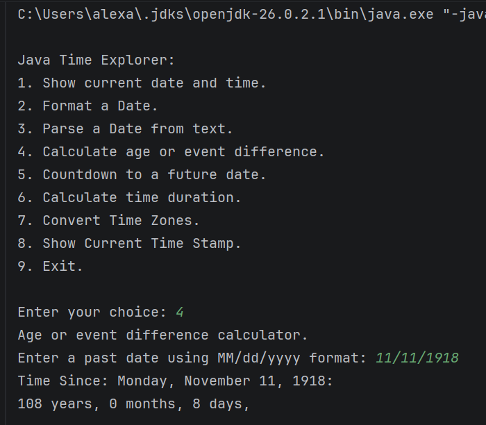
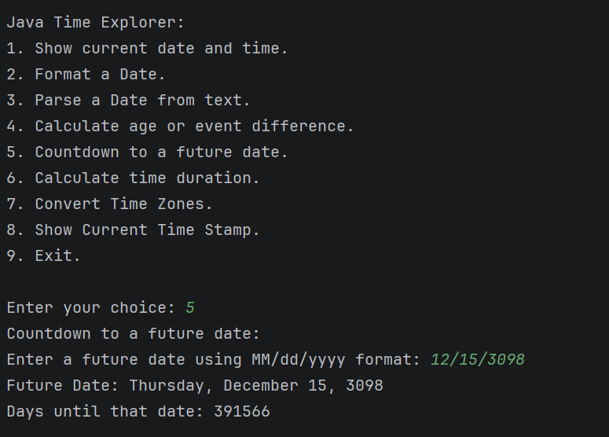
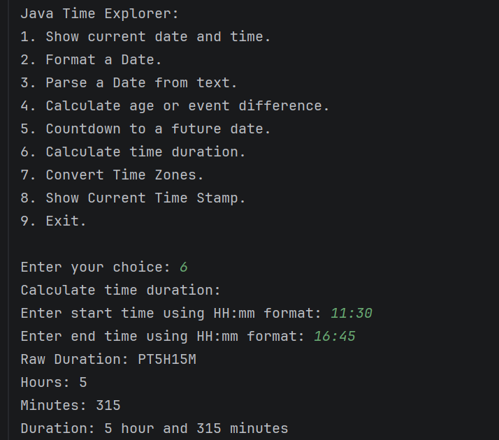
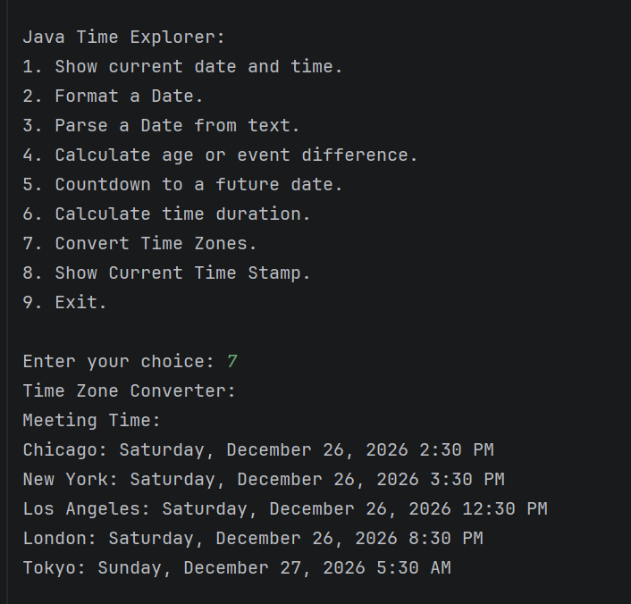
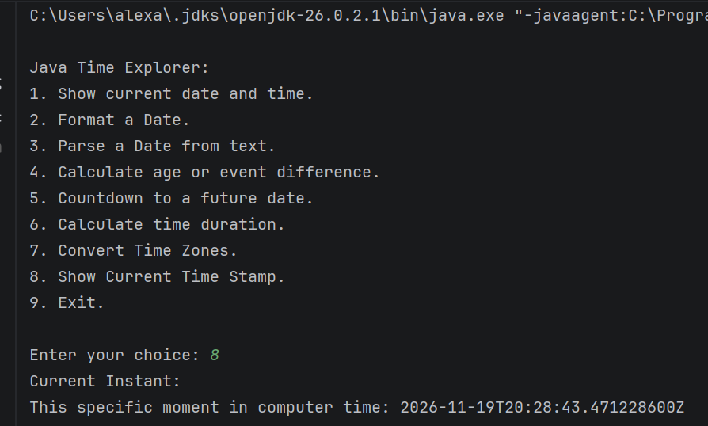

# Java Time Explorer

## Project Description

This Java console program demonstrates several features of Java's modern date and time API. The program uses a menu that allows the user to explore current dates and times, formatting and parsing, date differences, future countdowns, time durations, time zone conversions, and timestamps.

## Date and Time Features

The program demonstrates:

- Current date using `LocalDate`
- Current time using `LocalTime`
- Current date and time using `LocalDateTime`
- Date formatting using `DateTimeFormatter`
- Date parsing using `LocalDate.parse()`
- Date differences using `Period`
- Future-date countdowns using `ChronoUnit.DAYS`
- Time duration calculations using `Duration`
- Time zone conversions using `ZonedDateTime` and `ZoneId`
- Machine-friendly timestamps using `Instant`

## How to Run

1. Open the project in IntelliJ.
2. Open TimeExplorer.java and run.
3. Choose an option from the Java Time Explorer menu. 
4. Follow the prompts for the selected date or time feature. 
5. Return to the menu to try additional features.

## Screenshots

### Current Date and Time

### Current Date and Time Before Truncating

### Date Formatting

### Parsed Date

### Date or Event Difference

### Countdown to a Future Date

### Duration Between Times

### Time Zone Converter

### Instant Timestamp

## Reflection

### Which Java date/time class was easiest to understand?

LocalDate was the easiest for me to understand because it's just the date without needing to factor in a time or time zones. 
### Which Java date/time class was most confusing?

ZonedDateTime was more confusing because it combines a date, time, and time zone. Converting the same moment into several different time zones for a meeting required more info than working with only a date or only a time.

### Why is it better to use date/time classes instead of storing dates and times only as strings?

Java date and time classes allow the program to perform calculations/format dates/times and compare them. A string only stores text, so the program would need to interpret the value before modifying/converting the date or time.

### What is the difference between Period and Duration?

Period is used for differences between dates. Duration is used for differences between times.
### Why might time zones matter in real software?

Time zones matter because users and systems could be located in areas all over the world. A program may need to display the same event at different local times for everyone to meet at the same moment.